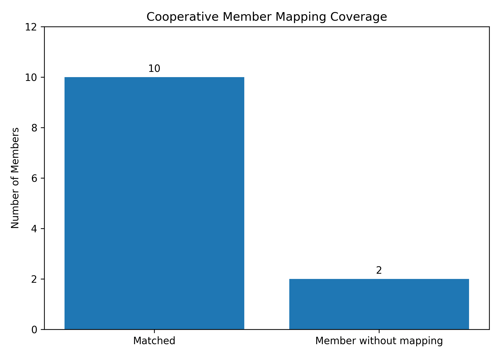
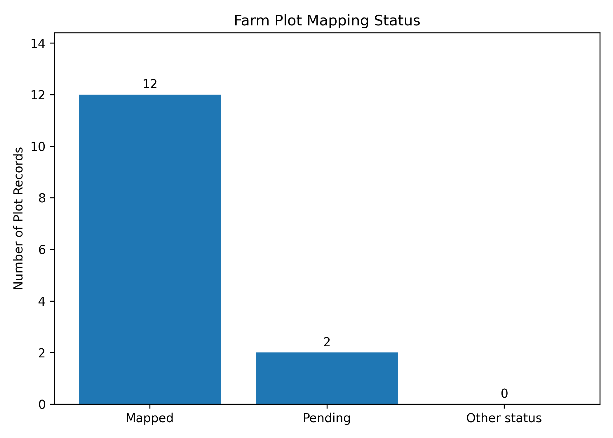
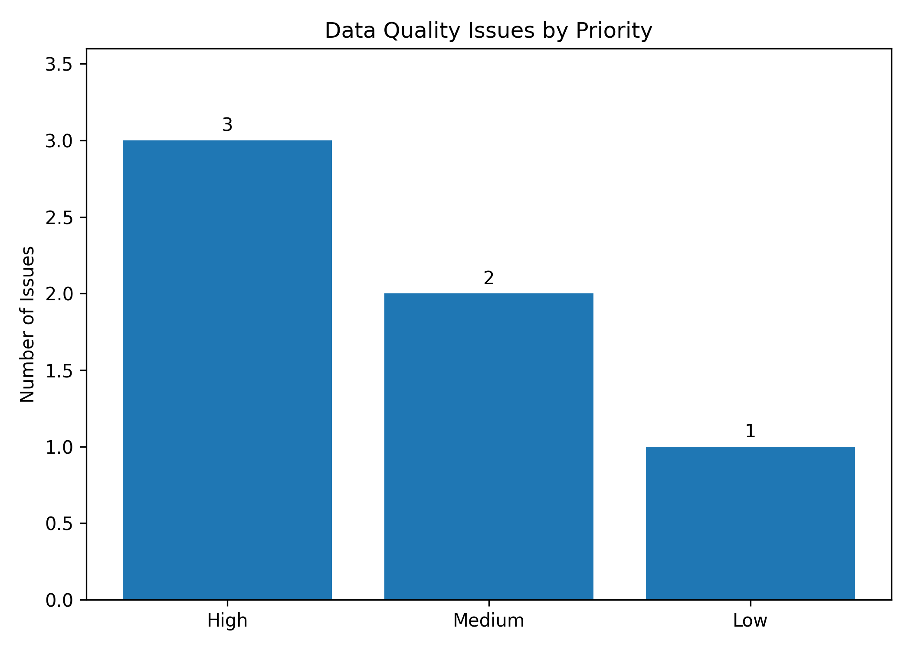

# Cooperative Data Reconciliation & KPI Dashboard

## Project Overview

This project demonstrates an end-to-end data reconciliation workflow for cooperative membership and farm mapping records. It combines member master data, farm-level records, reconciliation results, and data quality issues to support more reliable monitoring and follow-up.

The project focuses on identifying discrepancies between membership records and farm mapping data, measuring mapping coverage, prioritizing data quality issues, and generating KPI summaries and visualizations.

> **Note:** The figures presented in this project reflect the current working dataset. They should not be interpreted as actual organizational performance figures unless verified against the original records.

## Business Problem

Cooperative membership records and farm mapping data may be maintained separately. This can create several challenges:

- Members without corresponding farm mapping records.
- Farm records that cannot be linked to the member master.
- Incomplete administrative information, including missing identification data.
- Pending plot mapping activities.
- Limited visibility into data quality issues and their follow-up priorities.

Without a structured reconciliation process, these discrepancies can affect reporting accuracy, operational planning, and data-driven decision-making.

## Project Objectives

1. Reconcile cooperative membership and farm mapping records.
2. Measure member-level and plot-level mapping coverage.
3. Identify and classify data quality issues.
4. Prioritize follow-up actions based on issue severity.
5. Generate reproducible KPI summaries and visualizations.

## Tools & Technologies

- **Python** — data processing and analysis
- **Pandas** — data manipulation, aggregation, and reconciliation
- **Matplotlib** — KPI visualization
- **Google Colab** — analysis environment
- **GitHub** — project documentation and version control

## Methodology

### 1. Data Preparation
Review the structure of member and farm datasets, inspect column names, and assess record completeness.

### 2. Data Reconciliation
Compare member records with farm mapping records using member identifiers. Classify records based on their reconciliation status.

### 3. Data Quality Assessment
Identify issues such as members without mapping, mapping records without a corresponding master member, missing identification information, and pending plot records.

### 4. KPI Calculation
Calculate member mapping coverage and plot mapping coverage using their respective denominators.

### 5. Visualization and Reporting
Generate charts and export KPI summaries and issue tables to CSV for reporting and further analysis.

## Key Findings

Based on the current working dataset:

| KPI | Result |
|---|---:|
| Total member records | 12 |
| Members classified as matched | 10 |
| Members without mapping | 2 |
| Member mapping coverage | 83.33% |
| Total farm plot records | 14 |
| Mapped plots | 12 |
| Pending plots | 2 |
| Plot mapping coverage | 85.71% |
| Data quality issues | 6 |

### Interpretation

- Member mapping coverage and plot mapping coverage measure different aspects of reconciliation.
- Two plot records remain pending in the current dataset.
- Some records require additional verification before they can be considered fully reconciled.
- KPI interpretation depends on consistent record definitions, matching rules, and denominator selection.

These figures describe the current working dataset and should be revalidated whenever source data changes.

## Data Quality Findings

Examples of records requiring follow-up include:

- **M005:** An inactive member with no corresponding farm record in the current dataset.
- **M012:** An active member with missing identification information and no corresponding farm mapping record.
- **M013 / P011:** A mapped plot that cannot currently be linked to a member in the master dataset.

These cases should be investigated before modifying source records or treating the reconciliation as complete.

## Recommended Follow-up Actions

1. Verify unmatched plot records against membership documents.
2. Confirm whether inactive members should remain in operational mapping coverage calculations.
3. Complete missing administrative information where appropriate.
4. Investigate pending plot records with the relevant field team.
5. Recalculate KPIs after source data corrections.
6. Maintain an issue log with assigned owners, status, and verification dates.

## Outputs

The project generates:

- Member mapping coverage chart.
- Farm plot mapping status chart.
- Data quality issues chart.
- KPI summary CSV.
- Reconciliation results CSV.
- Farm summary CSV.

## KPI Visualizations

### Member Mapping Coverage

This chart compares cooperative members classified as matched with members without mapping records.

### Farm Plot Mapping Status

The current working dataset contains 14 plot records: 12 mapped and 2 pending, resulting in a plot mapping coverage of 85.71%.

### Data Quality Issues by Priority

This chart summarizes data quality issues by priority to support verification and follow-up planning.

## Conclusion

This project demonstrates a structured workflow for reconciling cooperative membership records with farm mapping data. By combining member-level and plot-level information, the analysis provides a clearer view of mapping coverage, unmatched records, and data quality issues requiring further verification.

In the current working dataset, 10 out of 12 member records are classified as having mapping records, equivalent to a member mapping coverage of 83.33%. Two member records remain without mapping records in the current reconciliation output.

Plot-level coverage is assessed separately from member-level coverage. Final plot coverage figures should be reported only after the total number of plot records, unique plot identifiers, and mapping statuses have been reconciled across the source data, KPI summary, and visualizations.

The analysis also produces a data quality issue log that can support verification and follow-up activities. These outputs are intended to help teams identify unresolved records and prioritize administrative or mapping checks.

## Recommendations

1. **Verify unmatched records.** Investigate members and farm mapping records that cannot be matched using the current identifiers.
2. **Standardize identifiers.** Apply consistent rules for member IDs and plot IDs before joining datasets.
3. **Resolve missing administrative information.** Review incomplete identification fields through authorized administrative processes.
4. **Prioritize unresolved mapping cases.** Assign follow-up owners and track issue status, verification dates, and resolutions.
5. **Standardize KPI definitions.** Document the denominator and eligibility rules used for member mapping coverage and plot mapping coverage.
6. **Refresh outputs after corrections.** Recalculate KPI summaries and regenerate visualizations whenever source records are updated.

## Limitations

The dataset used in this portfolio is synthetic and is intended to demonstrate analytical methods rather than represent verified operational performance. Matching status does not independently confirm the completeness or accuracy of every record, and mapping coverage does not establish the positional accuracy of farm boundaries.

The analysis should therefore be interpreted as a data reconciliation workflow and decision-support demonstration. Any operational action should be based on verified source records and appropriate review by the responsible team.

## Limitations

- The current dataset is small and should be treated as a working or demonstration dataset unless its provenance is independently verified.
- A matching status does not necessarily confirm that all member information is complete or valid.
- Plot-level coverage does not measure the quality or accuracy of polygon boundaries.
- Data quality issues require field or administrative verification before corrective action.
- Mapping coverage depends on the chosen denominator and eligibility rules.

## Future Improvements

- Automate data validation and reconciliation checks.
- Add an issue resolution tracking workflow.
- Develop an interactive dashboard.
- Introduce automated duplicate and missing-value detection.
- Integrate verified GIS attributes and polygon quality checks.
- Track mapping coverage over time.

## Skills Demonstrated

Data cleaning, data reconciliation, KPI development, data quality assessment, exploratory data analysis, visualization, Python programming, and analytical reporting.

---

*This project is intended to demonstrate a reproducible data reconciliation and monitoring workflow. Any public release should use synthetic or appropriately anonymized data and exclude confidential personal information.*
